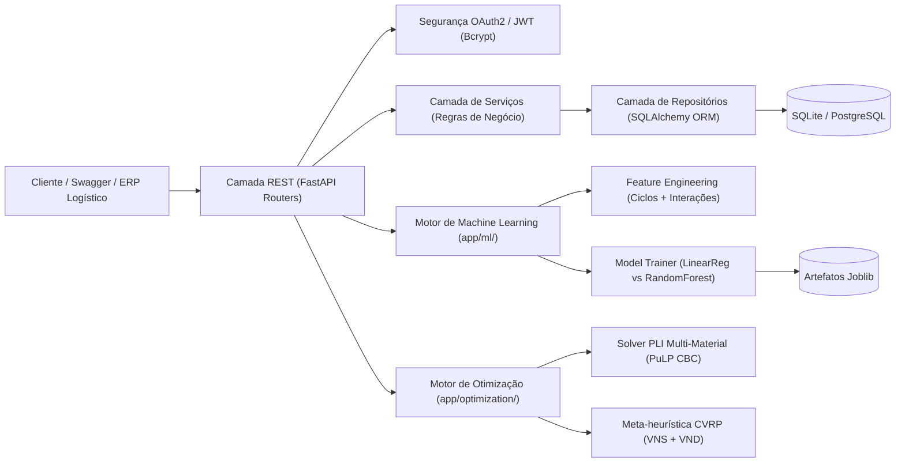

# SmartRoute OptiML API 🚛♻️🧠


Plataforma inteligente de **Engenharia de Software, Ciência de Dados e Pesquisa Operacional** para otimização logística de coleta seletiva urbana. O sistema integra três motores científicos em um único fluxo de decisão:

1. **Motor Preditivo (Machine Learning com Scikit-Learn):** Previsão diária do volume de recicláveis (**Papelão, Plástico, Alumínio e Peso Total**) por ecoponto, comparando *Multiple Linear Regression* e *Random Forest Regressor* com validação cruzada K-Fold.
2. **Motor de Programação Linear Inteira Mista (PuLP MILP):** Resolução exata do **Problema da Mochila Multi-Material Capacitado (Peso e Volume)**, maximizando o retorno econômico ($\text{R\$}$) e o impacto ambiental evitado ($\text{kg CO}_2\text{e}$).
3. **Motor de Roteirização Capacitada de Veículos (CVRP com Meta-heurística VNS):** Cálculo geodésico via fórmula de **Haversine**, heurística construtiva gulosa (*Nearest Neighbor*) e busca global **Variable Neighborhood Search (VNS)** acoplada ao **Variable Neighborhood Descent (VND)** nas vizinhanças $N_1$ (*Swap*), $N_2$ (*2-Opt*) e $N_3$ (*Relocate*).

---

## 🏛️ Arquitetura do Sistema

A aplicação segue os princípios de **Clean Architecture** e separação estrita de responsabilidades em camadas:



### Estrutura de Diretórios

```text
smartroute-optiml-api/
├── app/
│   ├── api/routers/          # Endpoints REST (Auth, CRUDs, Seed, ML, Otimização)
│   ├── core/                 # Config, Database, JWT Security, Global Exception Handlers
│   ├── ml/                   # Feature Engineering e Treinamento/Inferência Scikit-Learn
│   ├── models/               # Entidades ORM (Usuario, PontoColeta, HistoricoColeta, VeiculoFrota)
│   ├── optimization/         # Programação Linear Inteira (knapsack_milp.py) e VNS (vrp_vns.py)
│   ├── repositories/         # Persistência e consultas paginadas/filtradas
│   ├── schemas/              # Contratos e validações rigorosas Pydantic v2
│   ├── services/             # Lógica de domínio e gerador de dados sintéticos (data_seeder.py)
│   └── main.py               # Ponto de entrada FastAPI e metadados OpenAPI 3.1
├── docs/
│   └── RELATORIO_EXPERIMENTOS.md  # Relatório real gerado pelo script de benchmark
├── scripts/
│   └── run_benchmarks.py     # Benchmark experimental para 20, 50 e 100 pontos de coleta
├── tests/                    # Suíte automatizada Pytest (Unitários, Integração e E2E - 91% Cov)
├── Dockerfile                # Imagem de produção Python 3.12-slim
├── docker-compose.yml        # Orquestração pronta para produção
└── requirements.txt          # Dependências do projeto
```

---

## 📐 Formulação Matemática — Programação Linear Inteira (Mochila Multi-Material)

Dado um conjunto de pontos de coleta candidatos $I = \{1, 2, \dots, n\}$ e o conjunto de materiais recicláveis $M = \{\text{papelao}, \text{plastico}, \text{aluminio}\}$:

### Parâmetros
- $w_{i,m} \ge 0$: Peso disponível ($\text{kg}$) do material $m \in M$ no ponto de coleta $i \in I$.
- $v_{i,m} = w_{i,m} \cdot \gamma_m$: Volume ocupado ($\text{m}^3$) pelo material $m$ no ponto $i$, onde $\gamma_m$ é o volume específico ($\text{m}^3/\text{kg}$).
- $r_{i,m} = w_{i,m} \cdot p_m$: Valor financeiro ($\text{R\$}$) do material $m$ no ponto $i$, onde $p_m$ é o preço de comercialização por $\text{kg}$.
- $e_{i,m} = w_{i,m} \cdot c_m$: Emissões evitadas ($\text{kg CO}_2\text{e}$) pela reciclagem do material $m$ no ponto $i$.
- $\pi_i \ge 1$: Fator multiplicador de prioridade de esvaziamento sanitário do ecoponto $i$.
- $\alpha, \beta \in [0, 1]$: Pesos multicritério atribuídos ao retorno financeiro ($\alpha$) e ao impacto ambiental ($\beta$).
- $W_{\max}, V_{\max} > 0$: Capacidade máxima de carga ($\text{kg}$) e volume ($\text{m}^3$) do veículo/frota.

### Variáveis de Decisão
- $x_i \in \{0, 1\}$: $1$ se o ponto de coleta $i \in I$ é visitado/selecionado, $0$ caso contrário.
- $y_{i,m} \in \{0, 1\}$: $1$ se a carga do material $m \in M$ do ponto $i \in I$ é alocada no veículo, $0$ caso contrário.

### Função Objetivo
Maximizar a utilidade combinada econômico-ambiental ponderada pela prioridade de atendimento:

$$\max Z = \sum_{i \in I} \sum_{m \in M} \pi_i \cdot \left( \alpha \cdot r_{i,m} + \beta \cdot e_{i,m} \right) \cdot y_{i,m}$$

### Sujeito às Restrições

1. **Limite de Capacidade Física de Peso ($\text{kg}$):**
   $$\sum_{i \in I} \sum_{m \in M} w_{i,m} \cdot y_{i,m} \le W_{\max}$$

2. **Limite de Capacidade Volumétrica de Cubagem ($\text{m}^3$):**
   $$\sum_{i \in I} \sum_{m \in M} v_{i,m} \cdot y_{i,m} \le V_{\max}$$

3. **Acoplamento Ponto-Material (Coleta Integral ou Parcial):**
   - Modo Coleta Integral por Ecoponto:
     $$y_{i,m} - x_i = 0 \quad \forall i \in I, \forall m \in M$$
   - Modo Coleta Seletiva Parcial por Material:
     $$y_{i,m} - x_i \le 0 \quad \forall i \in I, \forall m \in M$$

4. **Domínio Binário:**
   $$x_i \in \{0, 1\}, \quad y_{i,m} \in \{0, 1\} \quad \forall i \in I, \forall m \in M$$

---

## 🔄 Meta-heurística VNS (Variable Neighborhood Search) para o CVRP

Para o **Problema de Roteamento de Veículos Capacitado (CVRP)**, as distâncias entre coordenadas $(\phi_a, \lambda_a)$ e $(\phi_b, \lambda_b)$ são calculadas sobre a esfera terrestre ($R = 6371.0088\text{ km}$) via **Fórmula de Haversine**:

$$d(a, b) = 2R \cdot \arctan2\left(\sqrt{\sin^2\left(\frac{\Delta \phi}{2}\right) + \cos(\phi_a)\cos(\phi_b)\sin^2\left(\frac{\Delta \lambda}{2}\right)}, \sqrt{1 - \left[\sin^2\left(\frac{\Delta \phi}{2}\right) + \cos(\phi_a)\cos(\phi_b)\sin^2\left(\frac{\Delta \lambda}{2}\right)\right]}\right)$$

### Estruturas de Vizinhança ($N_1, N_2, N_3$)

- **$N_1$ — Swap Intra-Rota:** Troca a posição de visitação entre dois clientes $u$ e $v$ pertencentes à mesma rota, reduzindo desvios locais.
- **$N_2$ — 2-Opt (Inversão de Segmento):** Remove duas arestas $(i, i+1)$ e $(j, j+1)$ de uma rota e reconecta invertendo a subsequência $[i+1 \dots j]$, eliminando cruzamentos geométricos no plano.
- **$N_3$ — Relocate Inter-Rotas e Intra-Rota:** Remove um ponto de coleta de sua rota de origem e o reinsere na posição de menor custo marginal em outra rota (desde que $\text{Carga}(R_{\text{dest}}) + q_u \le W_k$) ou na mesma rota.

### Pseudocódigo do Algoritmo VNS + VND

```text
Algoritmo: VNS_CVRP(Deposito, Pontos, Frota, max_iteracoes)
1. MatrizDist <- ConstruirMatrizHaversine(Deposito + Pontos)
2. S_atual <- HeuristicaGulosaNearestNeighbor(MatrizDist, Demandas, CapacidadesFrota)
3. S_melhor <- BuscaLocal_VND(S_atual, {N1_Swap, N2_2Opt, N3_Relocate})
4. Para iter = 1 até max_iteracoes faça:
5.     k <- 1
6.     Enquanto k <= 3 faça:
7.         S_shaken <- PerturbarSolucao_Shaking(S_melhor, vizinhanca = N_k)
8.         S_refinada <- BuscaLocal_VND(S_shaken, {N1_Swap, N2_2Opt, N3_Relocate})
9.         Se CustoDistancia(S_refinada) < CustoDistancia(S_melhor) então:
10.            S_melhor <- S_refinada
11.            k <- 1  # Reinicia na primeira vizinhança após melhoria
12.        Senão:
13.            k <- k + 1  # Avança para vizinhança mais ampla
14. Retornar S_melhor
```

---

## 📊 Resultados Experimentais Reais (`scripts/run_benchmarks.py`)

Resultados obtidos na avaliação cruzada de 5 folds ($1.250$ registros históricos) e nos testes de estresse de otimização combinatória:

### 1. Comparativo de Machine Learning (Previsão de Demanda)

| Algoritmo | $R^2$ Médio | MAE Médio (kg) | RMSE Médio (kg) | MAPE Médio (%) | Status |
| :--- | :---: | :---: | :---: | :---: | :---: |
| **Multiple Linear Regression** | `0.9661` | `10.2746` | `13.4189` | `4.83%` | Baseline |
| **Random Forest Regressor** | **`0.9724`** | **`8.6903`** | **`12.2933`** | **`3.86%`** | **Vencedor (Produção)** |

### 2. Escalabilidade e Convergência (PLI PuLP & Meta-heurística VNS)

| Cenário | Status Solver PLI | Tempo PLI | Rota Sequencial | Rota Gulosa (NN) | Rota Otimizada (VNS) | Economia vs Sequencial | Economia vs Gulosa (NN) |
| :--- | :---: | :---: | :---: | :---: | :---: | :---: | :---: |
| **20 Pontos** | `Optimal` | `47.61 ms` | `225.37 km` | `122.77 km` | **`102.42 km`** | **-54.55%** | **-16.58%** |
| **50 Pontos** | `Optimal` | `57.10 ms` | `590.98 km` | `206.03 km` | **`191.61 km`** | **-67.58%** | **-7.00%** |
| **100 Pontos** | `Optimal` | `57.15 ms` | `1272.50 km` | `362.10 km` | **`331.16 km`** | **-73.98%** | **-8.54%** |

> O relatório detalhado completo encontra-se em [`docs/RELATORIO_EXPERIMENTOS.md`](docs/RELATORIO_EXPERIMENTOS.md).

---

## 🌐 Tabela Completa de Endpoints REST

| Método | Endpoint | Tag | Autenticação | Descrição |
| :---: | :--- | :--- | :---: | :--- |
| `GET` | `/health` | Health | Pública | Verifica status e versão da API |
| `POST` | `/api/auth/registro` | Autenticação | Pública | Registra novo usuário com senha criptografada (Bcrypt) |
| `POST` | `/api/auth/login` | Autenticação | Pública | Autentica via JSON ou Form OAuth2 e retorna token JWT |
| `GET` | `/api/auth/me` | Autenticação | Bearer JWT | Retorna dados do usuário autenticado |
| `GET` | `/api/pontos-coleta` | Pontos de Coleta | Pública | Lista pontos com paginação e filtros (`cidade`, `bairro`, `tipo_zona`, `ativo`) |
| `GET` | `/api/pontos-coleta/{id}` | Pontos de Coleta | Pública | Obtém detalhes de um ecoponto por ID |
| `POST` | `/api/pontos-coleta` | Pontos de Coleta | Bearer JWT | Cadastra novo ponto de coleta |
| `PUT` | `/api/pontos-coleta/{id}` | Pontos de Coleta | Bearer JWT | Atualiza ponto de coleta existente |
| `DELETE` | `/api/pontos-coleta/{id}` | Pontos de Coleta | Bearer JWT | Remove ponto de coleta |
| `GET` | `/api/historicos-coleta` | Histórico de Coletas | Pública | Lista histórico com filtros de data, ponto, dia da semana e sazonalidade |
| `POST` | `/api/historicos-coleta` | Histórico de Coletas | Bearer JWT | Registra nova coleta pesada com cálculo automático de total e valor |
| `PUT` | `/api/historicos-coleta/{id}` | Histórico de Coletas | Bearer JWT | Atualiza registro histórico |
| `DELETE` | `/api/historicos-coleta/{id}` | Histórico de Coletas | Bearer JWT | Remove registro histórico |
| `GET` | `/api/veiculos-frota` | Frota de Veículos | Pública | Lista caminhões coletores com filtros de disponibilidade e capacidade |
| `POST` | `/api/veiculos-frota` | Frota de Veículos | Bearer JWT | Cadastra novo veículo validando placa Mercosul/antiga |
| `PUT` | `/api/veiculos-frota/{id}` | Frota de Veículos | Bearer JWT | Atualiza dados ou disponibilidade de veículo |
| `DELETE` | `/api/veiculos-frota/{id}` | Frota de Veículos | Bearer JWT | Remove veículo da frota |
| `POST` | `/api/seed/gerar-dados` | Data Seeder | Pública | Popula 25 ecopontos, 6 veículos e $>1.000$ históricos correlacionados |
| `POST` | `/api/ml/treinar-modelos` | Machine Learning | Pública | Treina e compara Linear Regression e Random Forest via Cross-Validation |
| `GET` | `/api/ml/metricas-comparativas` | Machine Learning | Pública | Retorna métricas $R^2$, MAE, RMSE e MAPE por alvo |
| `POST` | `/api/ml/prever-demanda` | Machine Learning | Pública | Prevê pesos de papelão, plástico, alumínio e valor financeiro por ponto |
| `POST` | `/api/otimizacao/alocacao-carga-pli` | Otimização | Pública | Resolve o Problema da Mochila Multi-Material via PuLP (MILP) |
| `POST` | `/api/otimizacao/roteamento-vns` | Otimização | Pública | Resolve o Roteamento de Veículos Capacitado (CVRP) via VNS + VND |
| `POST` | `/api/otimizacao/planejamento-integrado` | Otimização | Pública | Pipeline completo: Previsão ML $\rightarrow$ Seleção PLI $\rightarrow$ Roteirização VNS |

---

## 🚀 Guia Passo a Passo de Execução

### 1. Execução Local com Ambiente Virtual (`venv`)

```bash
# 1. Entrar no diretório do projeto
cd smartroute-optiml-api

# 2. Criar e ativar o ambiente virtual
python -m venv venv
# Windows (PowerShell):
.\venv\Scripts\Activate.ps1
# Linux / macOS:
source venv/bin/activate

# 3. Instalar dependências
pip install -r requirements.txt

# 4. Iniciar o servidor FastAPI com Uvicorn
uvicorn app.main:app --reload --host 0.0.0.0 --port 8000
```

Acesse a documentação interativa em:
- **Swagger UI:** `http://localhost:8000/docs`
- **ReDoc:** `http://localhost:8000/redoc`

### 2. Executar Suíte de Testes, Cobertura e Benchmarks

```bash
# Executar todos os 17 testes automatizados com relatório de cobertura
pytest --cov=app -v

# Executar o benchmark experimental (20, 50 e 100 pontos) e atualizar docs/RELATORIO_EXPERIMENTOS.md
python scripts/run_benchmarks.py
```

### 3. Execução via Docker e Docker Compose

```bash
# Construir e subir o container em background
docker compose up --build -d

# Verificar logs e status de saúde
docker compose logs -f
curl http://localhost:8000/health
```
